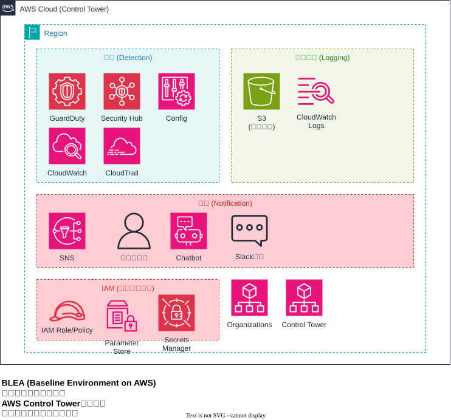

# BLEA Governance Base Control Tower



## 概要

AWS CDK（TypeScript）を使用して、AWS Control Tower 環境向けのガバナンスベースラインを構築します。  
BLEA（Baseline Environment on AWS）のガバナンスベース構成をカスタマイズしたものです。

### 構成するAWSリソース

#### 検知（Detection）
- **AWS Config** - デフォルトセキュリティグループの閉鎖を確認するルール（`bb-default-security-group-closed`）
- **AWS Config 自動修復** - 非準拠のセキュリティグループルールを SSM Automation で自動除去
- **Amazon GuardDuty** - 脅威検知（中～高重大度の検知結果を通知）
- **AWS Security Hub** - セキュリティ標準への準拠確認（CRITICAL/HIGH 重大度・FAILED の検知結果を通知）
- **Amazon CloudWatch** - CloudTrail ログを監視し、以下のイベントを検知：
  - IAM ポリシー変更
  - 不正アクセス試行
  - 新規 IAM アクセスキー作成
  - ルートユーザーアクティビティ
  - セキュリティグループ変更
  - ネットワーク ACL 変更
  - CloudTrail 設定変更
  - AWS Health イベント

#### ログ記録（Logging）
- **AWS CloudTrail** - API 呼び出しの記録（Control Tower 管理）
- **Amazon CloudWatch Logs** - CloudTrail ログの集約・フィルタリング
- **Amazon S3** - ログの長期保管

#### 通知（Notification）
- **Amazon SNS** - セキュリティアラームのトピック（メール購読設定）
- **AWS Chatbot** - Slack チャンネルへの通知（Slack Workspace・Channel ID で設定）

#### セキュリティ（IAM）
- **IAM ロール・ポリシー** - Systems Manager Automation 実行用ロール
- **AWS SSM Parameter Store** - 環境設定（環境名、通知メール、Slack 設定）の安全な保管
- **AWS Secrets Manager** - シークレット情報の管理
- **AWS Organizations** - Control Tower との連携

## パラメータストアの設定

AWS CLIを使用してパラメータストアを設定するには、以下のコマンドを実行します。

### 開発環境（dev）のパラメータ設定

```bash
# 環境名の設定
aws ssm put-parameter \
  --name "/blea/dev/envName" \
  --value "Development" \
  --type "SecureString" \
  --key-id "alias/aws/ssm" \
  --overwrite

# セキュリティ通知メールの設定
aws ssm put-parameter \
  --name "/blea/dev/securityNotifyEmail" \
  --value "notify-security@example.com" \
  --type "SecureString" \
  --key-id "alias/aws/ssm" \
  --overwrite

# Slack Workspace IDの設定
aws ssm put-parameter \
  --name "/blea/dev/securitySlackWorkspaceId" \
  --value "TXXXXXXXXXX" \
  --type "SecureString" \
  --key-id "alias/aws/ssm" \
  --overwrite

# Slack Channel IDの設定
aws ssm put-parameter \
  --name "/blea/dev/securitySlackChannelId" \
  --value "CXXXXXXXXXX" \
  --type "SecureString" \
  --key-id "alias/aws/ssm" \
  --overwrite
```


## デプロイ手順

### パッケージのインストール

```
npm i --package-lock-only
npm ci
npm install -D tsx
```

### デプロイ

```
npx aws-cdk bootstrap --profile default
npx aws-cdk deploy --all --profile default
```