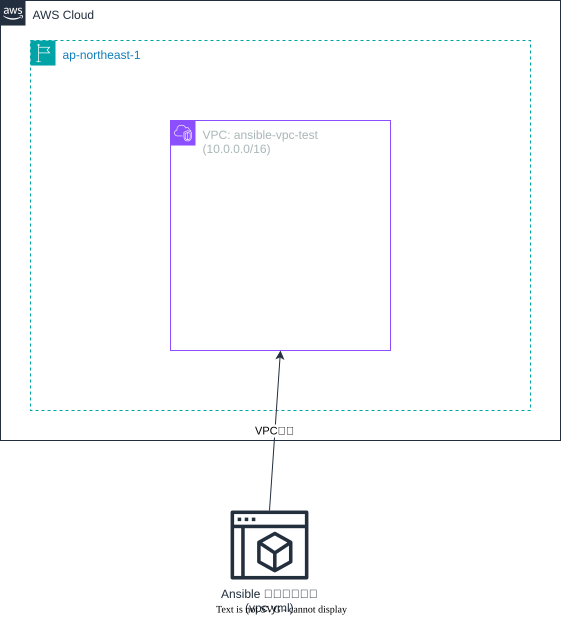

# Ansible VPC テスト構成

このAnsibleプレイブックは、AWSでVPCリソースの作成をテストするための構成です。



## 構成内容

### Ansibleプレイブック
- `vpc.yml`: VPC作成用のメインプレイブック
  - VPCの作成（名前: `ansible-vpc-test`、CIDRブロック: `10.0.0.0/16`、リージョン: `ap-northeast-1`）

### スクリプト
- `scripts/run-playbook.sh`: プレイブック実行用のシェルスクリプト

## 使用方法

1. AWS CLIの認証設定を完了してください
2. Ansibleがインストールされていることを確認してください
3. 以下のコマンドでプレイブックを実行します：

```bash
cd 025.ansible-vpc-test
./scripts/run-playbook.sh
```

または直接Ansibleコマンドを実行：

```bash
ansible-playbook vpc.yml
```

## 前提条件

- Ansible 2.9以上
- AWS CLI設定済み
- 適切なAWS権限（VPCの作成権限）

## 注意事項

- これはテスト用の構成です
- 実行前にAWSの認証情報が正しく設定されていることを確認してください
- 作成されたリソースは適切に削除してください